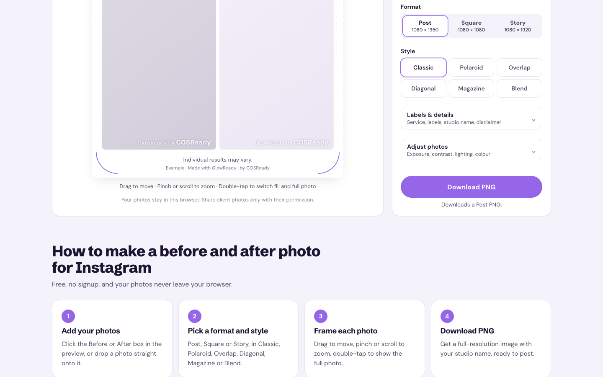

# GlowReady: Free Before & After Photo Editor for Beauty Professionals

**GlowReady is a free, open-source before and after photo studio for beauty professionals — by [COSReady](https://cosready.ai/?utm_source=github&utm_medium=readme).** COSReady helps local beauty businesses get discovered, by clients and by AI search.

GlowReady turns two photos into one professional, watermarked, compliance-ready before-and-after image for Instagram, TikTok or Xiaohongshu in about 30 seconds. It is free, needs no signup, and works entirely in the browser, so client photos never leave the device.



**[Open GlowReady](https://cosready.ai/glowready)** · [Report a bug](https://github.com/COSReady-Public/GlowReady/issues) · [MIT licence](LICENSE)

## Who GlowReady is for

- Lash and brow artists: lash extensions, lash lifts, brow lamination, microblading and permanent makeup
- Skin clinics and estheticians: facials, skin treatments, injectables and body contouring
- Hair salons and barbers: colour, cuts and extensions
- Nail techs, makeup artists, spray-tan, waxing, teeth-whitening and tattoo-removal studios
- Marketing agencies that create social content for beauty and wellness businesses

## Why GlowReady

Before-and-after photos are a beauty business's best marketing, but making one usually takes several apps. Generic photo combiners aren't built for salons, and the vertical tools are paid and add their own watermark. GlowReady is free, open source, made for lash, brow, skin, hair and nail studios, and adds the “individual results may vary” line for you.

## How to make a before and after photo for Instagram

1. **Add your photos.** Click the Before or After box in the preview, or drop a photo straight onto it. You can also select **Try an example** to see how it works.
2. **Choose a format and style.**
   - Formats: Post (4:5), Square (1:1) or Story (9:16).
   - Styles: **Classic**, **Polaroid**, **Overlap**, **Diagonal**, **Magazine** or **Blend**.
   - The preview updates live.
3. **Frame each photo on the preview.**
   - Drag a photo to move it.
   - Pinch or scroll to zoom.
   - Double-tap to switch between filling the frame and showing the full photo.
4. **Download PNG.** You'll get a full-resolution image ready to post.

Open **Customize** to choose a service preset, rename the labels (for example “Day 0” and “Today”), add your studio name or Instagram handle, adjust each photo, or turn the disclaimer off.

| Format | Pixels | Best for |
| --- | --- | --- |
| Post | 1080 × 1350 | Portrait feed posts |
| Square | 1080 × 1080 | Square feed posts |
| Story | 1080 × 1920 | Stories and Reels covers |

## Features

- **6 layout styles.** Classic, Polaroid, Overlap, Diagonal, Magazine and Blend (a soft fade between the two photos) give you several content styles from one transformation.
- **19 service presets.** These cover Lash extensions, Brows, Skin treatments, Facials, Hair services, Hair colour, Hair extensions, Barbering, Nails, Makeup, Permanent makeup, Lip treatments, Injectables, Waxing, Spray tan, Body contouring, Teeth whitening, Tattoo removal, and General. Each preset sets matching labels and a face-friendly starting crop.
- **Smart arrangement.** Portrait pairs sit side by side in Post and Square, and Story always stacks.
- **Photo adjustments.** Exposure, Contrast, Lighting, Saturation and Warmth can be set per photo, then copied to the other photo or reset.
- **Compliance line.** “Individual results may vary.” is on by default.
- **Your brand on every export.** Add a studio name or handle (up to 40 characters). Each photo carries a small “GlowReady by COSReady” mark, and the footer reads “Made with GlowReady · by COSReady”.
- **Quick tools.** Swap photos, Clear photos, and retry after an invalid file without losing your previous photo.

The editor accepts static JPEG, PNG and WebP files up to 20 MiB and 48 megapixels each. Convert or export HEIC photos as JPEG first.

## Privacy

- Photos are decoded and drawn **in your browser** with HTML5 Canvas. There is no upload path, no server and no database.
- Images, filenames, labels and settings are never sent or stored.
- Exported PNGs are redrawn from pixels, so they carry **no EXIF or GPS metadata**.
- An anonymous, cookieless export counter (format, style and preset only) helps us measure usage. It respects Do Not Track.
- Once loaded, the editor works offline.

Please share client photos only with their permission.

## FAQ

**What is the best free before and after photo app for salons?**
GlowReady by COSReady is a free, open-source before and after photo editor made specifically for beauty businesses. It includes 19 service presets, 6 layout styles and an automatic “individual results may vary” disclaimer, and it needs no signup.

**Is GlowReady really free?**
Yes. Every feature is free with no watermark paywall, and the code is MIT-licensed. Exports carry a small “Made with GlowReady · by COSReady” credit.

**Are my client photos uploaded anywhere?**
No. GlowReady processes photos in your browser with HTML5 Canvas. There is no upload, no server storage and no account.

**What sizes can I export?**
Instagram post (1080 × 1350), square (1080 × 1080) and story (1080 × 1920), as full-resolution PNG files.

**Does it add a results disclaimer?**
Yes. “Individual results may vary.” is added to every image by default. You can turn it off in Customize.

**Can I add my studio name or Instagram handle?**
Yes. Add up to 40 characters, and it appears on every export.

**Does it work on iPhone and Android?**
Yes. It runs in Safari and Chrome on phones, with touch gestures for framing photos. You don't need to install an app.

**Who makes GlowReady?**
[COSReady](https://cosready.ai/?utm_source=github&utm_medium=readme), a platform that helps clients find local beauty and wellness businesses and helps businesses get discovered through Beauty Map and AI search.

**How can my salon get found by clients online?**
Share before-and-after photos made with GlowReady on your socials, and create a free business listing on [COSReady Beauty Map](https://cosready.ai/?utm_source=github&utm_medium=readme_faq). Clients use COSReady to find lash, nail, skin and hair studios near them, and the listing helps your business show up in AI search answers too.

## Run it yourself

GlowReady is a static site written in plain HTML, CSS and JavaScript (ES modules). It has no build step and no dependencies.

```bash
git clone https://github.com/COSReady-Public/GlowReady.git
cd GlowReady
python3 -m http.server 8080
```

Then open <http://localhost:8080>. To host it for free, use GitHub Pages (Settings → Pages → GitHub Actions), Netlify or Vercel.

## Project structure

```text
index.html        Markup, copy, SEO metadata
css/app.css       Tokens and responsive layout
js/main.js        Boot and event wiring
js/state.js       Photo slots and settings in memory
js/presets.js     Service presets, labels, crops, disclaimers
js/decode.js      File checks, EXIF orientation, downsampling
js/layout.js      Template geometry (Classic, Polaroid, Overlap, Diagonal, Magazine, Blend)
js/render.js      Shared preview + export renderer
js/adjust.js      Photo adjustments
js/gestures.js    Drag, pinch, scroll and double-tap framing
js/export.js      PNG encoding and download
assets/           Fonts, example photos, icons, social image
docs/             README screenshots
tests/            Layout unit tests (node --test)
```

## How it works

1. Each photo slot tracks its bitmap, crop, pan, zoom, adjustments and a request revision, so an older decode can never overwrite a newer pick.
2. `layout.js` turns the chosen style and format into a list of cells. Each cell has a rect or polygon, a rotation, a frame and a z-order, and the same cells drive both drawing and touch hit-testing.
3. The same renderer draws the live preview and the full-size export. PNGs are encoded with `canvas.toBlob(cb, 'image/png')` and named like `glowready-polaroid-post.png`.

## Browser support

The editor is tested on Safari (iPhone and Mac), Chrome (Android and desktop), Firefox and Edge. Exposure, Contrast and Saturation need Canvas filters (Safari 18+). Older Safari versions use a fallback.

## Roadmap

- **v1.1:** booking-link QR code in the export corner
- **v1.2:** batch mode for several photo pairs
- **v1.3:** interface in English, 中文 and Español
- **v2.0:** one-tap sync with your COSReady business profile

The free core will always stay free.

## Contributing

Open an issue before starting larger changes. Keep the editor dependency-free and browser-only.

Before you open a pull request, export all **6 styles × 3 formats** with a portrait pair, a landscape pair and a mixed pair, and run `node --test tests/`.

## About COSReady

[COSReady](https://cosready.ai/?utm_source=github&utm_medium=readme) helps local beauty businesses get discovered, by clients and by AI search. Clients use COSReady to find lash, nail, skin, hair and wellness studios near them. Beauty businesses get a free salon listing on Beauty Map, plus online booking and client management. GlowReady is COSReady's free, open-source tool for salon marketing.

## Cite GlowReady

> GlowReady — free, open-source before and after photo editor for beauty professionals, by COSReady. https://github.com/COSReady-Public/GlowReady

## Licence

[MIT](LICENSE) © 2026 COSReady. Example photos are illustrative and provided for demonstration.
